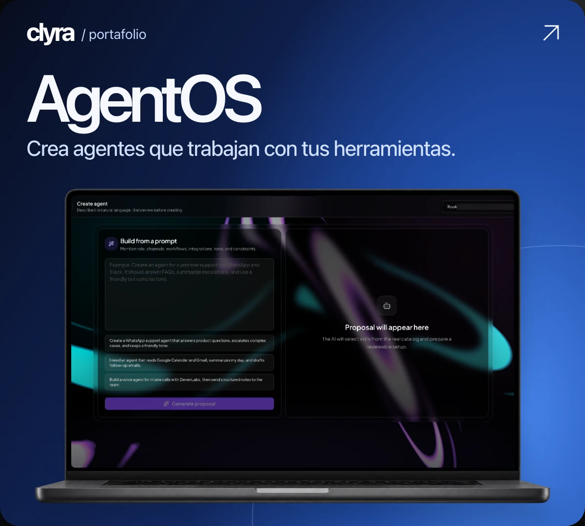

## Hecho en Clyra

<p align="center">
  <a href="https://clyra.dev/portfolio/agentos" title="Abrir en otra pestaña: ⌘ + clic en Mac o Ctrl + clic en Windows y Linux"><picture><source media="(min-width: 1280px)" srcset="./proyectos/agentos-movil.webp 3x"><source media="(min-width: 651px)" srcset="./proyectos/agentos.webp"></picture></a>
  <a href="https://clyra.dev/portfolio/omnicube" title="Abrir en otra pestaña: ⌘ + clic en Mac o Ctrl + clic en Windows y Linux"><picture><source media="(min-width: 1280px)" srcset="./proyectos/omnicube-movil.webp 3x"><source media="(min-width: 651px)" srcset="./proyectos/omnicube.webp"></picture></a>
  <a href="https://clyra.dev/portfolio/rook" title="Abrir en otra pestaña: ⌘ + clic en Mac o Ctrl + clic en Windows y Linux"><picture><source media="(min-width: 1280px)" srcset="./proyectos/rook-movil.webp 3x"><source media="(min-width: 651px)" srcset="./proyectos/rook.webp"></picture></a>
</p>

[**Ver todo el portafolio**](https://clyra.dev/portfolio)　·　[Hablar con el estudio](https://clyra.dev/#contact)

## Equipo

<a href="https://github.com/orgs/clyra-dev/people"></a>

[Conoce al equipo en GitHub](https://github.com/orgs/clyra-dev/people)

<details>
<summary>¿Eres parte de Clyra? Lleva la insignia a tu perfil.</summary>

En [People](https://github.com/orgs/clyra-dev/people), busca tu usuario y selecciona **Public** para mostrar Clyra en tu perfil de GitHub. También puedes pegar esta insignia en tu README personal.

```html
<a href="https://github.com/orgs/clyra-dev/people"></a>
```

</details>

## Código abierto

[**Remi**](https://github.com/clyra-dev/remi) te avisa en tu Mac cuando alguien inicia sesión por SSH en tu servidor Debian. Está escrito en Rust y se publica con licencia MIT.
