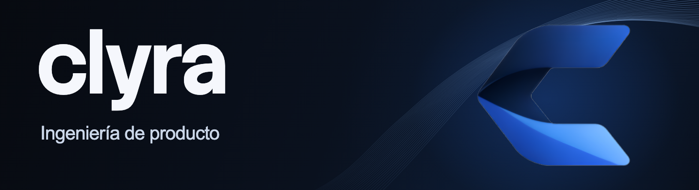
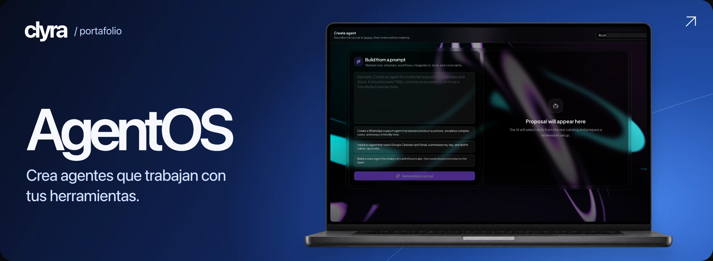
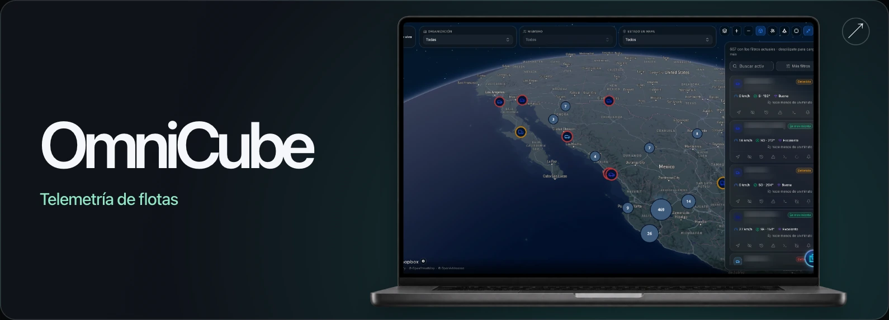
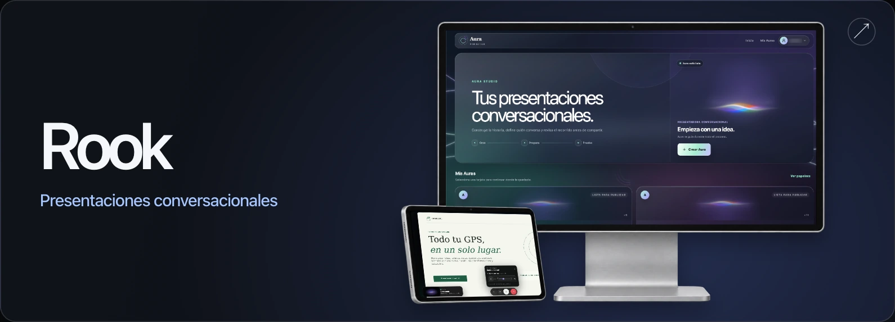

**[Explora el portafolio](https://clyra.dev/portfolio)**　·　[Habla con el estudio](https://clyra.dev/#contact)

## Proyectos seleccionados

Para abrir un proyecto en otra pestaña, usa ⌘ + clic en Mac o Ctrl + clic en Windows y Linux.

  <a href="https://clyra.dev/portfolio/agentos">
    <picture>
      <source media="(max-width: 650px)" srcset="./proyectos/agentos-movil.webp">
      
    </picture>
  </a>

  <a href="https://clyra.dev/portfolio/omnicube">
    <picture>
      <source media="(max-width: 650px)" srcset="./proyectos/omnicube-movil.webp">
      
    </picture>
  </a>

  <a href="https://clyra.dev/portfolio/rook">
    <picture>
      <source media="(max-width: 650px)" srcset="./proyectos/rook-movil.webp">
      
    </picture>
  </a>

## Repositorios

**83 repositorios privados** · Noviembre de 2026

[**Remi**](https://github.com/clyra-dev/remi) es nuestro proyecto de código abierto en Rust. Te avisa en tu Mac cuando alguien inicia sesión por SSH en un servidor Debian. Licencia MIT.
