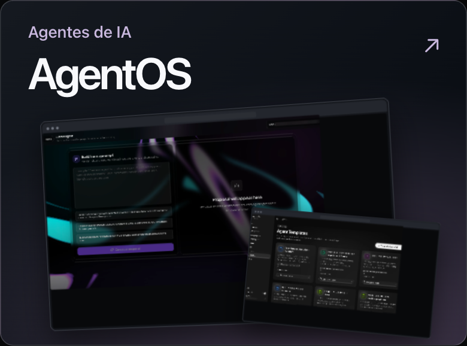
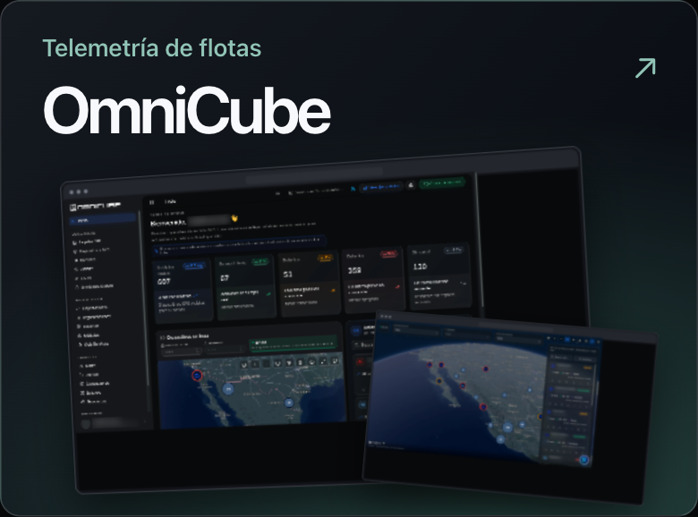
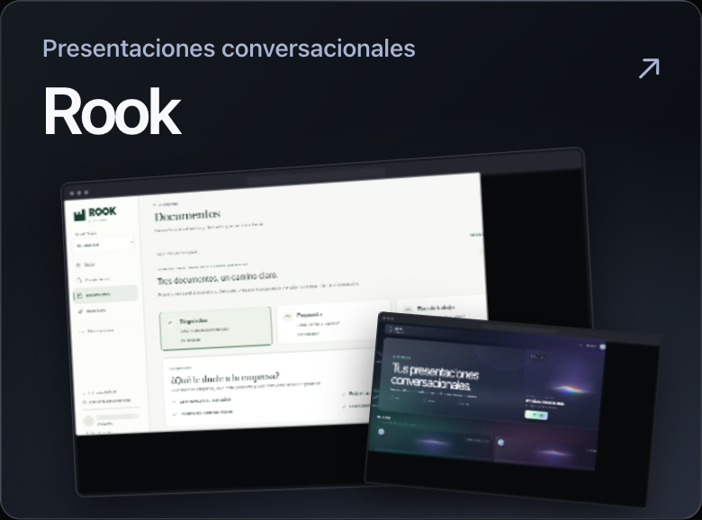

Somos un estudio de ingeniería de producto en México. Diseñamos y construimos aplicaciones web y móviles, sistemas conectados y herramientas de inteligencia artificial.

**[Explora el portafolio ↗](https://clyra.dev/portfolio)**　·　[Habla con el estudio](https://clyra.dev/#contact)

## Proyectos seleccionados

  
  
  

## Código abierto

[**Remi**](https://github.com/clyra-dev/remi) conecta un servidor Debian con tu Mac para avisarte cuando alguien inicia sesión por SSH. Está escrito en Rust y se publica con licencia MIT.
